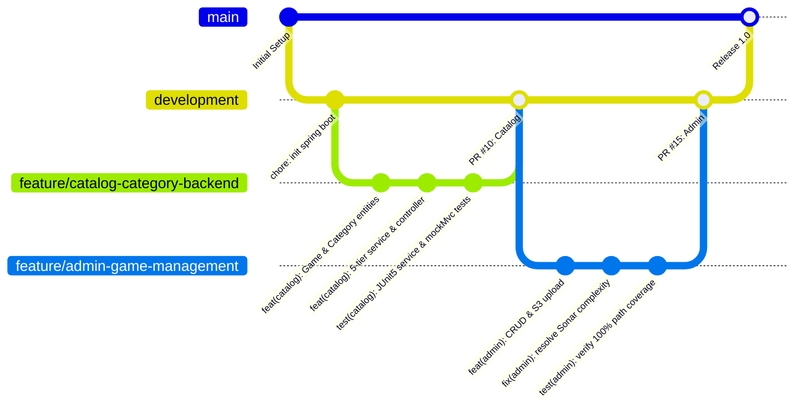

# Mouse Jerry – Backend API

Re-engineered RESTful backend service for the **Mouse Jerry** digital game store, migrated from the legacy Node.js/Express + MongoDB monolith (SE262) to an enterprise-grade, strongly typed architecture built with **Spring Boot 4 / Java 21**, **PostgreSQL**, and **AWS S3 / Supabase Storage**.

---

## 🛠 Technology Stack

- **Framework**: Spring Boot (Java 21)
- **Database**: PostgreSQL (Relational schema with normalized tables, foreign keys, and indexes)
- **Persistence**: Spring Data JPA / Hibernate (with MapStruct DTO projections)
- **Security**: Spring Security 6 with stateless JWT authentication (`jjwt 0.12.6`) and BCrypt password hashing
- **Object Storage**: AWS S3 SDK v2 (`software.amazon.awssdk`) with automatic local filesystem fallback
- **Testing & Quality**: JUnit 5, Mockito, JaCoCo (Coverage Engine), SonarCloud, DeepSource

---

## 🏛 System Architecture

The service enforces a **strict 5-tier layered architecture** with zero layer-skipping:

```
[ HTTP Client / Frontend SPA ]
              │
              ▼
    1. Controller Layer (@RestController) ── Validates input (@Valid), maps HTTP responses
              │
              ▼
    2. Service Layer (Interface + @Service) ── Enforces business rules & @Transactional boundaries
              │
              ▼
    3. DAO Layer (Interface + @Repository) ── Abstract data access contracts (@Profile("db"))
              │
              ▼
    4. Repository Layer (JpaRepository) ── Spring Data JPA & dynamic Criteria/Specifications
              │
              ▼
    5. Database Layer (PostgreSQL) ── Normalized tables with CASCADE & SET NULL integrity
```

DTO isolation is strictly preserved using **MapStruct (`LabMapper`)** to prevent lazy-loading crashes, bidirectional JSON serialization recursion, and entity state leakage.

---

## 🔄 Git & CI/CD Workflow

Our team used a **Trunk/GitFlow Hybrid with Feature-to-PR Protocol**:
- Direct commits to `main` and `development` are blocked.
- All functional changes live on ephemeral `feature/<name>` or `fix/<name>` branches.
- Every PR must satisfy the SonarCloud quality gate and pass automated testing before peer review.



---

## 🚦 Getting Started

### Prerequisites
- **JDK 21** or later
- **Maven 3.9+** (or use the provided `./mvnw` wrapper)
- **PostgreSQL 15+** (configured in `application.properties` or environment variables)

### Running the Application Locally

```bash
# Clone repository
git clone <repository-url>
cd se327-mouse-jerry-backend

# Run automated tests and generate JaCoCo coverage
./mvnw clean test

# Generate JaCoCo HTML report in target/site/jacoco/index.html
./mvnw jacoco:report

# Start Spring Boot server on http://localhost:8080
./mvnw spring-boot:run
```

---

## 📊 Software Metrics & Quality Gates

| Metric | Target Gate | Current Status |
|---|---|---|
| **Test Suites** | 100% Passing | **256 passing (0 failures, 0 errors)** |
| **Line Coverage (JaCoCo)** | $\ge 80\%$ | **95.5% (969 / 1,015 lines)** |
| **Branch Coverage (JaCoCo)** | $\ge 80\%$ | **83.4% (357 / 428 branches)** |
| **SonarCloud Rating** | Grade A | **Grade A (Security, Reliability, Maintainability)** |
| **DeepSource Status** | Grade A | **Zero blocking issues (Java & SQL)** |

---

## 💡 Key Learnings ("What I've Learned")

1. **Database-Level Integrity Over Application Glue**:
   - In SE262, MongoDB stored categories as ad-hoc string arrays without referential integrity, creating orphan strings and data drift on category rename/delete.
   - Migrating to PostgreSQL taught us the power of normalized foreign key constraints (`ON DELETE CASCADE` and `ON DELETE SET NULL`), transferring data integrity guarantees from fragile application code to the database engine.

2. **JPA Query Optimization & DTO Boundaries**:
   - Encountered Hibernate N+1 query cascades and bidirectional serialization recursion when modeling M:N `game_categories` relations.
   - Solved this by decoupling domain entities from client payloads using MapStruct DTO projections (`LabMapper`) and distinct join specifications (`query.distinct(true)`).

3. **Hybrid Resilience Patterns for Cloud Storage**:
   - Learned that third-party cloud integrations (like Supabase S3) must not become single points of failure in CI or local development.
   - Designed a fallback mechanism that attempts pre-signed S3 uploads, but automatically stores files on the local filesystem if credentials or signatures fail, keeping builds deterministic.

4. **Guiding Autonomous AI with Measurable Quality Gates**:
   - Operating under the "Human-as-Conductor, AI-as-Implementer" model proved that AI-generated code will rapidly accumulate cyclomatic complexity (e.g. Sonar/DeepSource `JS-R1005 > 5`) unless bounded by strict automated linting, test-coverage floors, and review gates.
